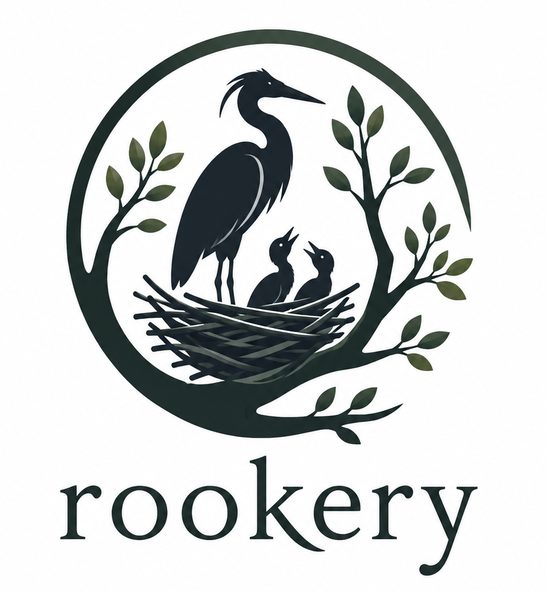

<p align="center">
  
</p>

<h1 align="center">Rookery</h1>

<p align="center">
  <em>Label an issue. Get a draft PR.</em>
</p>

<p align="center">
  
  
  
</p>

---

Rookery watches your repos for a `claude:trigger` label. When one lands it plans
the issue, asks its questions as issue comments, waits for a human `approve`,
then implements the plan task by task on a branch and opens a draft PR.

```
claude:trigger → planning → awaiting-input ⇄ awaiting-approval → implementing → reviewing → done
```

Two files: `agent.py` (the pipeline) and `web.py` (the webhook, sign-in, the API and the
portal in `ui/`) — Python stdlib only, plus the `gh`, `openssl` and `claude` CLIs on your
PATH. The full roadmap lives in
[ai-plans/github-issue-agent-plan.md](ai-plans/github-issue-agent-plan.md).

## Quick start

```bash
cp .env.example .env            # WEBHOOK_SECRET, APP_ID, APP_KEY
python agent.py owner/repo 12   # dry run: plan issue 12 without a webhook
```

## Requirements

| Needs | Why |
| --- | --- |
| `gh`, authenticated | reads issues, posts comments, opens the PR |
| `claude` CLI | plans and implements |
| `git` with a global `user.name` / `user.email` | the orchestrator commits |
| Python 3.10+ | no packages to install |

## How it works

### This repo is the orchestrator, never the target

Rookery never runs inside the repo it is working on. It works on every repo
the GitHub App is installed on: at startup it lists them, clones each into
`work/repos/<owner>_<repo>` and uses its default branch as the base. Adding a repo
to the installation makes it live, and removing it deletes the clone, with no
restart needed. There is no repo list to maintain.

Each issue gets its own `git worktree` under `work/<owner>_<repo>/issue-<n>` on
branch `feature/issue-<n>`, so two repos can share an issue number without
colliding. Your own checkouts are never touched.

### State lives in the target repo

```
agent-plans/<n>/
  plan.md        # the approved plan
  tasks.md       # - [ ] checklist — the ORCHESTRATOR ticks, never the agent
  decisions.md   # append-only; the agent writes, the next task reads
```

All three are committed and pushed with the change, so they land in the PR.
Nothing persists locally between runs.

### One task, one session

After approval the orchestrator loops: take the first unticked task → start a
**fresh Claude session** for that task alone → require `STATUS: task-done` →
tick the checkbox, `git commit`, next.

Fresh sessions per task keep context — and cost — flat no matter how large the
issue is. `decisions.md` is the only memory that crosses between them.

- More than **15 tasks** is an error: split the issue.
- A failed task stops at `claude:error` with everything before it already
  committed. Fix the plan or the code, comment `approve` again, and the loop
  resumes at that same task.

### Two named roles

`agent.py:AGENTS` defines two, passed to the CLI as `--agents`/`--agent`:

| Role | Runs | Can it write? |
| --- | --- | --- |
| **planmaker** | the planning phase | `agent-plans/<n>/` only — anything else it touches is reverted before the plan is posted, every time `plan()` is called |
| **reviewer** | once, after the last task, before the push | no — it reports, it never fixes |

Implementation tasks run as *no* agent: the plain harness with the deny rules
is already the right shape for them.

The reviewer is **advisory**. Its findings go into the PR body under
`## Review`, and the draft PR opens whatever the verdict — work is never left
stranded in a local worktree. A `changes-needed` verdict only lands
`claude:error` so somebody looks. Blocking and self-fixing variants are specced
but deliberately unbuilt.

To split models by role, add `"model": "opus"` to a role in `AGENTS`.

## Setup

1. Fill in `.env`.
2. Install the GitHub App on the target repos.
3. Point the App's webhook (App settings → *Webhook URL*) at
   `https://smee.io/<your-channel>`, with the same secret. There is no per-repo
   webhook.
4. Branch-protect `main`. The code refuses to push there; protection is the
   backstop, not the primary guard.
5. Run the server and point smee at it:

   ```bash
   python agent.py
   npx smee-client --url https://smee.io/<your-channel> --target http://127.0.0.1:8787/
   ```

Labels are created when a repo is onboarded.

## Using it

Add the `claude:trigger` label to an issue, then follow the `claude:*` label:

| Label | Meaning |
| --- | --- |
| `claude:planning` | writing the plan |
| `claude:awaiting-input` | a question is in the comments — answer it |
| `claude:awaiting-approval` | comment `approve` / `lgtm` / `go ahead` |
| `claude:implementing` | working through `tasks.md` |
| `claude:reviewing` | the reviewer is reading the finished diff |
| `claude:done` | draft PR is open, review clean |
| `claude:error` | the exception is the last comment, or the reviewer wants changes; fix, unlabel, re-trigger |

Only people with write access to the repo can move an issue along, and approval is a regex
(`agent.py:APPROVE`) — never an LLM judgement. The agent itself is blocked from
`git push` and `gh`; it never publishes.

Each repo gets 10 `claude` calls and $20 a day (UTC), recorded in `$WORKSPACE/rookery.db`;
override with `RUN_CAP`/`USD_CAP` in `.env`. A `PAUSED` file next to `agent.py` stops every
new call. Hitting either comments on the issue and sets `claude:error`.

## Testing without a webhook

The dry-run forms go through the same `handle()` as the webhook — only the
transport differs. Use them instead of standing up smee:

```bash
python agent.py owner/repo 12              # plan the issue, as if just labelled
python agent.py owner/repo 12 approve      # run the task loop, push, open the PR
python agent.py owner/repo 12 use sqlite   # anything else is fed back as a reply
python test_agent.py                       # the gates, no network
```

## The portal

`python agent.py` also serves a small control plane at `PUBLIC_URL` (default
`http://127.0.0.1:8787/`). Sign in with GitHub — the App's own OAuth, so set `CLIENT_ID` /
`CLIENT_SECRET` from the App's settings and add `PUBLIC_URL/auth/callback` as its callback
URL. You see the repos of your own installations of the App, and for each:

- today's runs and dollars against the caps;
- every run (plan, reply, implementation), and where it is or where it stopped —
  *"Failed at task 9 of 12"* — read from the run log in `rookery.db`, not the journal;
- a run's log step by step: tasks, each `claude` call with its status and cost, commits,
  push, PR, the error;
- **Cancel** on a running job (write access needed): the `claude` call is killed and the
  issue gets the error comment and `claude:error`, like any failure. `approve` resumes it.

There is no approve button. Approval stays an `approve` comment on the issue.

Sessions are server-side and last 8 hours. Your GitHub token is used once at sign-in to
list your installations and is not kept. Over the internet, put it behind a TLS reverse
proxy and set `PUBLIC_URL=https://…` (that also turns on the `Secure` cookie flag).

`REPOS_ONLY=owner/a,owner/b` limits an instance to those repos — for a local copy next to
a server on the same App.

## Not built yet

Phase 6 of [ai-plans/PRD-Phases.md](ai-plans/PRD-Phases.md): a second harness.

One worker per repo: repos run in parallel, but within a repo it is one job at a
time — deliberately. A long implementation blocks the other issues of *that* repo.
