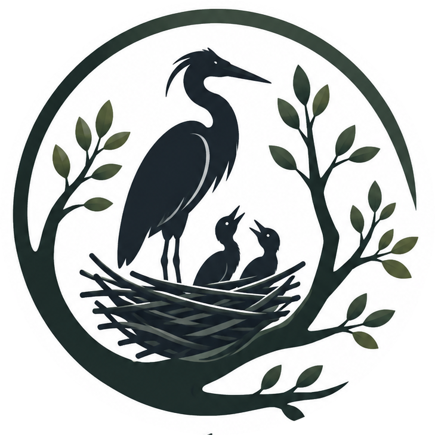
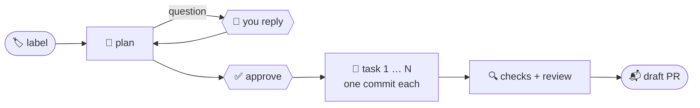

<p align="center">
  
</p>

<h1 align="center">Rookery</h1>

<h3 align="center">Label an issue. Get a reviewed draft PR.</h3>

<p align="center">
  A self-hostable GitHub App that turns issues into pull requests the way a careful teammate would:<br>
  it <b>plans</b>, <b>asks</b>, waits for your <code>approve</code>, then <b>builds it task by task</b> — and never merges.
</p>

<p align="center">
  <a href="https://rookery.run"></a>
  <a href="https://github.com/sa-es-ir/rookery/stargazers"></a>
  
  
  
  <a href="LICENSE"></a>
</p>

<p align="center">
  <a href="https://rookery.run"><b>Website</b></a> ·
  <a href="docs/getting-started.md"><b>Get started</b></a> ·
  <a href="docs/overview.md"><b>Docs</b></a> ·
  <a href="https://youtu.be/oyhMn-B0spI"><b>Demo video</b></a> ·
  <a href="docs/self-hosting.md"><b>Self-host</b></a>
</p>


## ✨ Why Rookery

Most coding agents either chat with you in an editor or open a PR you didn't ask for.
Rookery sits where your team already works — **GitHub issues** — and keeps a human on
every gate that matters.

<table>
  <tr>
    <td width="33%" valign="top">
      <h4>🏷️ One label to start</h4>
      Add <code>rookery:trigger</code> to an issue. That's the whole UI.
    </td>
    <td width="33%" valign="top">
      <h4>🗺️ Plan first, code second</h4>
      A written plan and task list arrive as a comment. Nothing is built until someone with write access says <code>approve</code>.
    </td>
    <td width="33%" valign="top">
      <h4>🧱 One task, one session</h4>
      Every task gets a fresh agent session and its own commit, so cost and context stay flat however big the issue is.
    </td>
  </tr>
  <tr>
    <td valign="top">
      <h4>🔍 Reviewed before you see it</h4>
      A reviewer agent, plus any checks you configure, reads the finished diff. Findings go in the PR body.
    </td>
    <td valign="top">
      <h4>🛡️ The agent never publishes</h4>
      It cannot <code>git push</code> or call <code>gh</code>. The orchestrator commits and opens a <b>draft</b> PR. Merging is always yours.
    </td>
    <td valign="top">
      <h4>🔁 Resumable</h4>
      A failed task stops with everything before it committed. Comment <code>approve</code> again and it resumes at that task.
    </td>
  </tr>
  <tr>
    <td valign="top">
      <h4>🧠 Learns your repo</h4>
      Short per-repo notes carry lessons from one run to the next.
    </td>
    <td valign="top">
      <h4>💸 Hard caps</h4>
      Per-repo daily limits on calls and dollars, checked before every single call.
    </td>
    <td valign="top">
      <h4>🪶 Tiny</h4>
      Two Python files, stdlib only. No database server, no queue, no framework.
    </td>
  </tr>
</table>

## ⚙️ How it works



The plan, the task list and a `decisions.md` log ship with the PR, so reviewers see
_why_, not only _what_. Follow the issue's `rookery:*` label to see where it is:

<details>
<summary><b>The labels, one per phase</b></summary>

| Label                       | Meaning                                                        |
| --------------------------- | -------------------------------------------------------------- |
| `rookery:planning`          | writing the plan                                               |
| `rookery:awaiting-input`    | a question is in the comments — answer it                      |
| `rookery:awaiting-approval` | read the plan, then comment `approve` / `lgtm` / `go ahead`    |
| `rookery:implementing`      | working through the task list                                  |
| `rookery:reviewing`         | the reviewer is reading the finished diff                      |
| `rookery:done`              | the draft PR is open and the review is clean                   |
| `rookery:changes-wanted`    | the draft PR is open; the reviewer or a check wants changes    |
| `rookery:error`             | the reason is the last comment; fix it, then `approve` resumes |

</details>

### 💬 Follow-ups and PR reviews

- **On the issue, once its PR is open:** mention `@rookery-agent` with a note —
  _"rename the flag"_, _"why this index?"_ — and it updates the PR or answers the question.
- **On any open PR:** mention `@rookery-agent` (or add the `rookery:pr-review` label, or
  request a review from it) for one advisory review: a verdict, a findings table and
  details. Steer it with a note — `@rookery-agent check the migration`.

## 🚀 Get started

### Hosted — two minutes

1. Open **[rookery.run](https://rookery.run)** and sign in with GitHub.
2. Install the App on a repo and add your model key.
3. Label an issue `rookery:trigger`.

Full guide: [docs/getting-started.md](docs/getting-started.md).

### Self-host

You need Python 3.10+, `git`, `openssl`, the [`gh`](https://cli.github.com) CLI and the
[`claude`](https://docs.claude.com/en/docs/claude-code) CLI on your PATH, plus your own
GitHub App. **No packages to install.**

```bash
git clone https://github.com/sa-es-ir/rookery && cd rookery
cp .env.example .env               # WEBHOOK_SECRET, APP_ID, APP_KEY, ...
python agent.py owner/repo 12      # dry run: plan issue 12, no webhook needed
python agent.py                    # webhook + portal on http://127.0.0.1:8787
```

For local development, forward the App's webhook with
`npx smee-client --url https://smee.io/<channel> --target http://127.0.0.1:8787/`.
For a real server, follow [docs/self-hosting.md](docs/self-hosting.md) and the full
Linux guide in [DEPLOY.md](DEPLOY.md).

## 🔑 Model providers

The agent harness is always the [Claude Code](https://docs.claude.com/en/docs/claude-code)
CLI, so every safety rule holds whichever model is behind it. The model is chosen per
GitHub owner: an owner's own key, or the operator's default.

| Provider               | Status       | Models behind the agent                    |
| ---------------------- | ------------ | ------------------------------------------ |
| **Claude** (CLI login) | ✅ Supported | Opus plans and reviews, Sonnet builds      |
| **Anthropic API key**  | ✅ Supported | Same Claude models, billed to your key     |
| **DeepSeek**           | ✅ Supported | DeepSeek V4 Pro / Flash                    |
| **Z.ai (GLM)**         | ✅ Supported | GLM 5.3 / GLM 5.3 Flash                    |
| **OpenRouter**         | 🧪 Next      | GPT and Gemini models, after quality tests |
| **Claude on Bedrock**  | 📋 Planned   | Claude through your own AWS account        |
| **Codex CLI**          | 🔭 Later     | OpenAI models in their native harness      |

Owners add keys on the portal's **Keys** page. Keys are encrypted at rest, never shown
again (only the last 4 characters), and the daily caps still apply.
More: [docs/keys.md](docs/keys.md).

## 🎛️ Make it yours

A repo steers its own runs from files on its **base branch** — never from the branch the
agent edits, so a config change takes effect only after a human merges it.

| File                                         | What it does                                                                      |
| -------------------------------------------- | --------------------------------------------------------------------------------- |
| `CLAUDE.md`                                  | read like it is for your own developers                                           |
| `.rookery/workflow.json`                     | agent, skills and instructions per step, plus up to 5 `after` checks or writers   |
| `.rookery/agents/*.md`, `.rookery/skills/`   | your own agents and skills, or replacements for `planmaker` / `reviewer`          |
| `<owner>/.rookery`                           | defaults for every repo of an owner                                               |

```json
{
  "plan": {
    "skills": ["repo-recon"],
    "instructions": "Every schema change gets its own task."
  },
  "task": { "skills": ["verification-before-completion"] },
  "after": [
    { "agent": "reviewer", "mode": "check", "skills": ["security-review"] },
    { "agent": "docs", "mode": "write", "skills": ["changelog"] }
  ]
}
```

A bad config fails the run at start with a comment — Rookery never quietly falls back.
The built-in skill catalog is in [skills/](skills/README.md); the full reference is
[docs/configuration.md](docs/configuration.md) and [docs/workflow.md](docs/workflow.md).

## 🖥️ The portal

`python agent.py` also serves a small control plane. Sign in with GitHub and, for each
repo you installed the App on, see today's spend against the caps, every run and where it
stopped (_"Failed at task 9 of 12"_), each step with its cost, cancel a running job, and
view or propose workflow changes — as a pull request, never a direct write.

There is deliberately **no approve button**: approval stays an `approve` comment on the
issue, from someone with write access.

## 🛡️ Safety, in short

- Approval is a regex on a comment from a user with write access — **never an LLM judgement**.
- The agent is denied `git push` and `gh`; it runs with no MCP servers and loads no
  hooks or settings from the repo it edits.
- Planning can write only its plan files; anything else is reverted.
- Never pushes to the base branch; the GitHub token never enters the agent's environment.
- Caps (default 30 calls and $20 per repo per UTC day) are checked before every call; a
  `PAUSED` file next to `agent.py` stops all new calls.

Details: [docs/safety.md](docs/safety.md).

## 🗺️ Roadmap

- [x] GitHub App, onboarding without a restart, per-repo approval and caps
- [x] Parallel repos, portal, run log, cancel
- [x] Per-repo workflows, custom agents and skills, owner defaults
- [x] PR reviews on request, follow-ups, repo memory
- [x] Multiple model providers and bring-your-own-key
- [ ] OpenRouter (GPT, Gemini) — after tool-use quality tests
- [ ] Claude on Bedrock — when an owner asks
- [ ] A second harness (Codex CLI) — on demand

Want one of these sooner? [Open an issue](https://github.com/sa-es-ir/rookery/issues).

## 🤝 Contributing

Issues and PRs are welcome. The test suite needs no setup:

```bash
python test_agent.py   # the whole suite: plain asserts, no framework, no network
```

<details>
<summary><b>Dry runs — the webhook's code path, without a webhook</b></summary>

```bash
python agent.py owner/repo 12              # plan the issue, as if just labelled
python agent.py owner/repo 12 approve      # run the task loop, push, open the draft PR
python agent.py owner/repo 12 use sqlite   # anything else is fed back as a reply
python agent.py owner/repo 12 @rookery-agent check the migration   # review PR 12
```

</details>

`agent.py` is the pipeline; `web.py` is the webhook, sign-in, API and the portal in `ui/`.
[CLAUDE.md](CLAUDE.md) documents the architecture and the invariants that must not be
softened — read it before a change to the safety rules.

## ⭐ Star history

<a href="https://star-history.com/#sa-es-ir/rookery&Date">
  <picture>
    <source media="(prefers-color-scheme: dark)" srcset="https://api.star-history.com/svg?repos=sa-es-ir/rookery&type=Date&theme=dark">
    
  </picture>
</a>

## 📄 License

Rookery is licensed under the [GNU Affero General Public License v3.0](LICENSE). You can
use, modify and self-host it freely. If you run a modified version as a network service,
you must make your source available to its users. The skills adapted from
[superpowers](skills/LICENSE-superpowers) keep their MIT license.

<p align="center"><sub>If Rookery saves you a PR, a ⭐ helps others find it.</sub></p>
